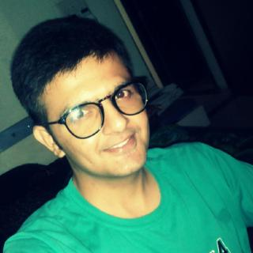
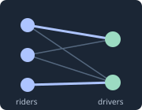
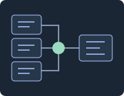

::: {.mobile-profile}
{.mobile-profile-photo}
:::

::: {.lead}
I work on **real-time data systems and machine-learning infrastructure**, with
interests in reliability, reproducibility, and the tools that connect research
to practice.
:::

My background spans streaming pipelines, cloud infrastructure, and data
engineering with **Go, Python, Kafka, AWS, and Google Cloud**. My published work
connects these interests to distributed analytics, crop-yield prediction,
educational software, and IoT security.

::: {.intro-links}
[Research interests](research/index.qmd)
[Published artifacts](publications/index.qmd)
[Selected projects](contributions/index.qmd)
[Background & experience](about/index.qmd)
:::

## Research interests

::: {.interest-grid}
::: {.interest-item}
### Streaming systems

How data moves, joins, and changes when the input never stops.
:::
::: {.interest-item}
### ML & data infrastructure

Connecting production data, model-serving systems, and reliable operations.
:::
::: {.interest-item}
### Research tooling

Making questions, sources, code, and published artifacts easier to trace.
:::
:::

## Selected work

::: {.work-entry}
::: {.work-media}

:::
::: {.work-description}
[Engineering project · Kafka · Spark · Python]{.record-type}

### [UMatch: matching over streaming data](contributions/umatch/index.qmd)

Constructing rider and driver streams from taxi-trip data, grouping nearby
candidates with geohashes, and applying greedy distance-based matching within a
streaming window.

::: {.artifact-links}
[Case study](contributions/umatch/index.qmd)
[Code ↗](https://github.com/raxit65535/umatch)
[Demo ↗](https://www.youtube.com/watch?v=JHGOzwrlW8s)
:::
:::
:::

::: {.work-entry}
::: {.work-media}

:::
::: {.work-description}
[Research infrastructure · LangGraph · Quarto]{.record-type}

### [From research question to reviewable artifact](contributions/research-workflows/index.qmd)

An autonomous workflow connecting literature discovery, configurable models,
source metadata, Quarto drafts, and a human-reviewed publication boundary.

::: {.artifact-links}
[Architecture](contributions/research-workflows/index.qmd)
[Research workflow](research/index.qmd)
[Repository ↗](https://github.com/raxit65535/keep-it-simple)
:::
:::
:::

## Published artifacts

- **2019 · Thesis:** [Git-Archive Data Pipeline](publications/git-archive-data-pipeline/index.qmd) — streaming graph processing with Kafka and Flink.
- **2019 · IEEE CCWC:** [Prediction of Crop Cultivation](publications/prediction-of-crop-cultivation/index.qmd) — coauthored work on regression for crop-yield prediction.
- **2019 · IEEE CCWC:** [Hadoop and Apache Mahout](publications/hadoop-apache-mahout/index.qmd) — first-authored work on distributed data analysis.
- **2016 · IRJET:** [Online Examination Empowerment](publications/online-examination-empowerment/index.qmd) — an examination-preparation framework developed at Ganpat University.
- **2016 · IRJET:** [Accustoms of IOT and Security Concerns](publications/iot-security-concerns/index.qmd) — a survey of connected-device security.

[Full publication records, author lists, and citations](publications/index.qmd)

## Professional record

These sections stay visible as the record develops. An empty collection means
entries have not been added here—not that an achievement or recognition is claimed.

::: {.record-grid}
::: {.record-link}
### [Publications](publications/index.qmd)
Thesis, conference papers, journal articles, and citations.
:::
::: {.record-link}
### [Reviewing & service](service/index.qmd)
Completed reviewing and professional contributions.
:::
::: {.record-link}
### [Awards & honors](awards/index.qmd)
Recognitions with their granting organizations and dates.
:::
::: {.record-link}
### [Memberships](memberships/index.qmd)
Professional affiliations and membership grades.
:::
::: {.record-link}
### [Media & coverage](media/index.qmd)
External coverage of the work, with original sources.
:::
::: {.record-link}
### [Experience](about/index.qmd#experience)
Engineering roles, responsibilities, and background.
:::
:::

[Recognition overview](recognition/index.qmd) · [Talks and demonstrations](talks/index.qmd)

## Experience, briefly

| Period | Work |
| --- | --- |
| 2020–Present | **Shipt** — Senior Software Engineer, ML/data systems |
| 2020 | **Minted** — data engineering and streaming analytics |
| 2019 | **Globe Life / Insight Data Science** — cloud pipelines and data engineering |

[Full background and education](about/index.qmd)
